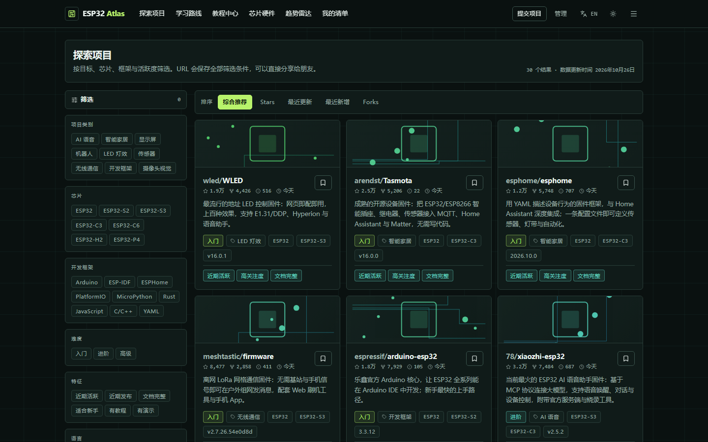
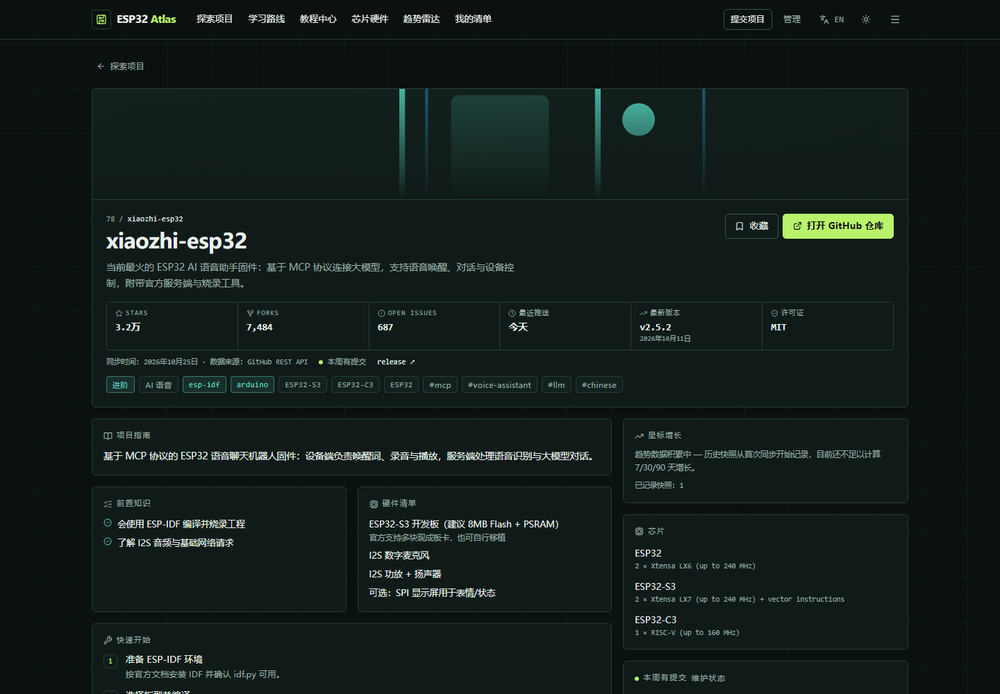
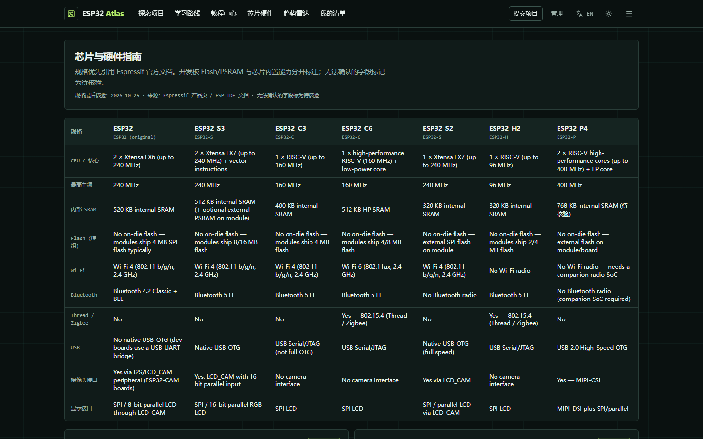
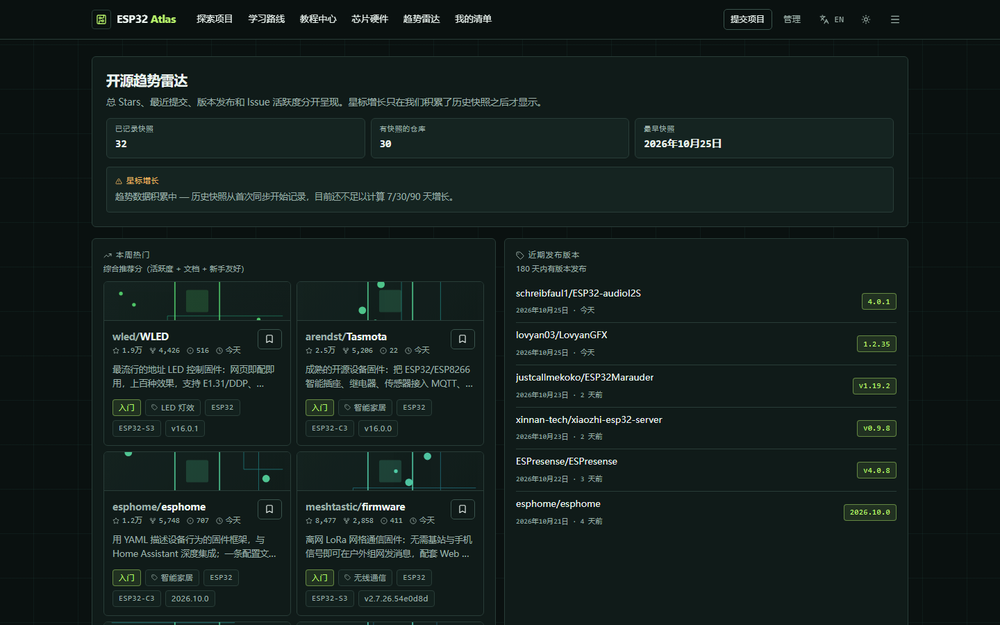
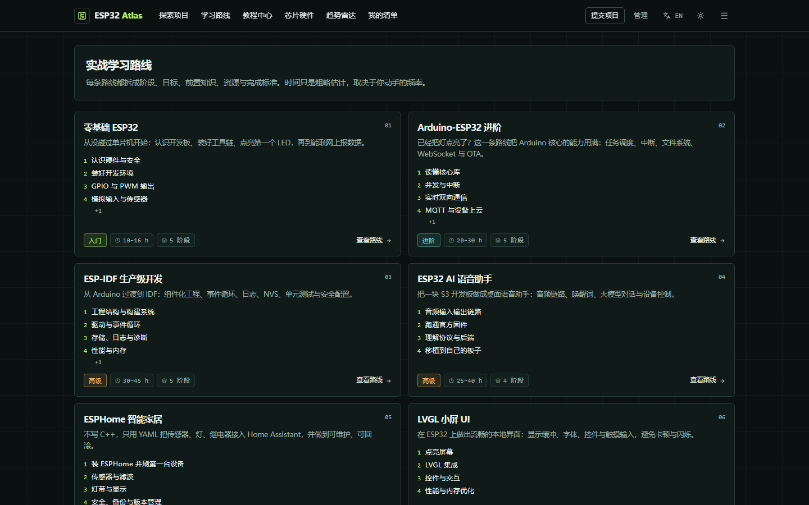
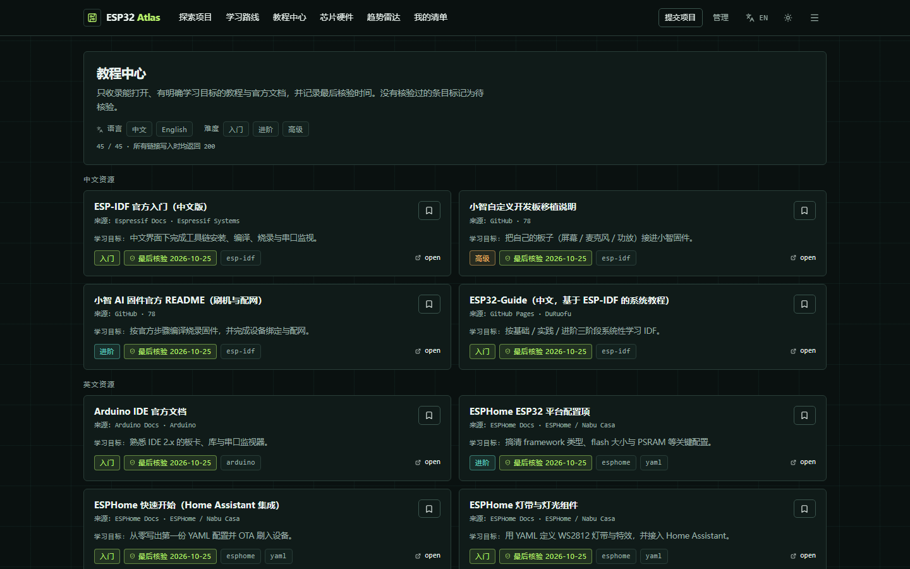
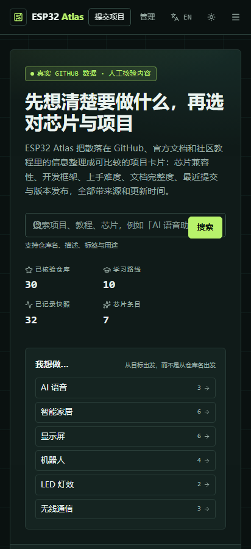
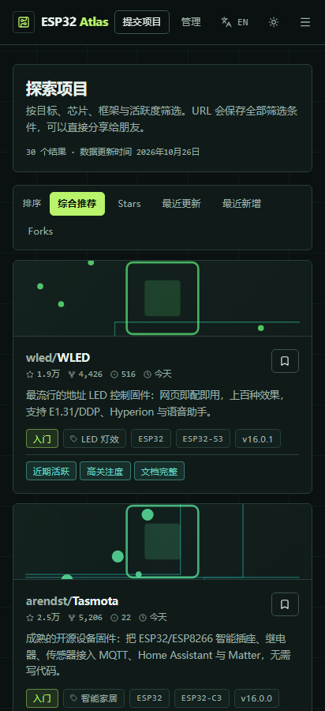

# ESP32 Atlas · The ESP32 open-source project map

> Find projects by goal, choose chips with evidence, and learn along a real path.
> 按目标找项目、按证据选芯片、按路线学到底.

[](https://esp32-atlas.changyuansex.workers.dev)
[](https://nextjs.org)
[](https://workers.cloudflare.com)
[](#tests-and-acceptance)
[](LICENSE)

[简体中文](README.md) · **English**

---

## What this is

ESP32 Atlas is not another awesome list. It answers four specific questions:

1. **I want to build an AI voice assistant / LED strip / e-paper weather station / smart-home device — which project do I start from?**
2. **Which repositories match my chip, framework, skill level and hardware budget?**
3. **Is this project actually still maintained right now?** (Total stars, recent pushes, releases and issue backlog, shown separately.)
4. **In what order do I learn, so that I actually ship something?**

It puts **live GitHub metrics**, hand-written **project guides**, **chip references** and **learning paths** into one comparable catalogue — and it labels what is fetched, what is editorial judgement, and what is still unverified.


---

## Capabilities

| Capability | How it works | Trust labelling |
| --- | --- | --- |
| Find by goal | 6 goal shortcuts + 9 category facets; the URL holds the full filter state | Empty results explain themselves instead of being padded |
| Compare projects | Chip compatibility, framework, difficulty, doc quality, demo usability, stars/forks/issues, last push, latest release, licence | Metrics come from the GitHub API; difficulty and scores are editorial and labelled as such |
| Activity radar | Total stars, 60/90-day pushes, releases within 180 days, issue-to-star ratio — each shown separately | **Star growth appears only when historical snapshots exist**; otherwise "trend data accumulating" |
| Learning paths | 10 paths; each stage has goals, prerequisites, resources, a rough time estimate and **observable completion criteria** | Times are explicitly rough estimates |
| Hardware guide | ESP32 / S2 / S3 / C3 / C6 / H2 / P4 comparison table plus detail cards | Cites Espressif pages; unconfirmable fields marked unverified |
| Tutorial hub | 46 Chinese/English tutorials and official docs with language, difficulty, source and last-verified date | Every link returned HTTP 200 when added |
| Collections | localStorage persistence, status (todo/doing/done), notes, JSON export/import | The page states plainly that data never leaves the browser |
| Submissions | GitHub URL validation → existence check → duplicate detection → review queue | Nothing appears in a listing before approval |
| Admin console | PBKDF2 passwords + D1 sessions + HttpOnly cookie; review submissions, trigger sync, inspect failures | Enforced server-side; hiding a link is not access control |
| Bilingual UI | Cookie-persisted zh/en across every page, empty state and chart label | Repo names, code and identifiers stay verbatim |

### Screens

| Explore (filters + sorting) | Project detail (live metrics + provenance) |
| --- | --- |
|  |  |

| Chip comparison | Activity radar |
| --- | --- |
|  |  |

| Learning paths | Tutorial hub |
| --- | --- |
|  |  |

| Mobile home | Mobile explore |
| --- | --- |
|  |  |

> All screenshots come from a running production build (`opennextjs-cloudflare preview` — real workerd runtime with a real D1 database), not from a design file.

---

## Live demo

<https://esp32-atlas.changyuansex.workers.dev>

Verified in production: `/`, `/explore`, `/projects/[slug]`, `/paths`, `/paths/[slug]`, `/tutorials`, `/hardware`, `/radar`, `/collections`, `/submit`, `/admin`, `/about`, `/robots.txt` and `/sitemap.xml` all return 200; an unknown project returns 404.

---

## Stack

```
Next.js 15.5 (App Router, RSC)  +  React 19  +  TypeScript 5.9
Tailwind CSS v4 (design tokens centralised in app/globals.css)
Cloudflare Workers (@opennextjs/cloudflare 1.20)
Cloudflare D1 (SQLite) — every query uses ? placeholders
Zod 4 (validation) · Web Crypto (PBKDF2 password hashing)
Vitest 3 (unit + content integrity) · Playwright 1.56 (desktop + mobile E2E)
```

**Why not a static site?** Because it needs a server-side GitHub token, a real database, admin authentication, a review queue and sync job history. Putting it on GitHub Pages would delete all of that, which contradicts the "trustworthy and maintainable" goal.

### Layout

```
esp32-atlas/
├─ app/                      # routes (all Server Components, reading D1 per request)
│  ├─ page.tsx               # home: goals / trending / active / beginner / new
│  ├─ explore/               # filters, sorting, pagination — all state in the URL
│  ├─ projects/[slug]/       # metrics + guide + similar projects + growth
│  ├─ paths/ , paths/[slug]/ # 10 learning paths
│  ├─ tutorials/             # tutorial hub (language / difficulty filters)
│  ├─ hardware/              # chip comparison table + spec cards
│  ├─ radar/                 # activity radar
│  ├─ collections/           # local collections
│  ├─ submit/                # project submission
│  ├─ admin/                 # admin console (server-side auth)
│  ├─ api/{auth,submit,admin} # route handlers
│  ├─ sitemap.ts, robots.ts  # SEO
│  └─ globals.css            # design tokens and component classes
├─ src/
│  ├─ content/               # curated content (curation / guides / paths / tutorials / chips)
│  ├─ lib/
│  │  ├─ db/                 # driver abstraction (D1 + node:sqlite), query helpers
│  │  ├─ search.ts           # pure filter / score / sort logic (unit tested)
│  │  ├─ sync.ts             # GitHub sync engine (backoff + snapshots)
│  │  ├─ auth.ts/password.ts # sessions + PBKDF2
│  │  ├─ i18n.ts             # every UI string (zh/en)
│  │  └─ collections.ts      # localStorage collections
│  └─ components/            # cards, filter panel, generated covers, preference controls…
├─ migrations/               # 0001_init.sql + 0002_seed.sql (generated)
├─ scripts/                  # fetch-github / build-seed / create-admin
├─ tests/                    # Vitest
├─ e2e/                      # Playwright (desktop + mobile)
└─ docs/                     # security review, architecture, deployment, screenshots
```

---

## Run locally

```bash
npm install

npm run db:migrate:local      # create tables
npm run db:seed               # regenerate migrations/0002_seed.sql from src/content + src/data
npm run db:migrate:local      # apply the seed

npm run dev                   # http://localhost:3100  (D1 emulated by Miniflare)
```

> Windows note: if Miniflare reports `CreateDirectory: access denied`, point `TEMP` at a writable directory — this project was verified using `.tmp-work/`.

### Production build

```bash
npm run build                 # next build (type check + optimised build)
npm run preview:cf            # run the Workers output locally on workerd (closest to production)
npx opennextjs-cloudflare build && npx opennextjs-cloudflare deploy
```

---

## Environment variables

Copy `.env.example`:

| Variable | Purpose | Required |
| --- | --- | --- |
| `GITHUB_TOKEN` | Server-side GitHub metric sync (5000 req/h; anonymous 60 req/h without it) | Recommended |
| `SYNC_TOKEN` | Bearer token for scheduled calls to `POST /api/admin/sync` | Required in production |
| `SITE_URL` | Absolute base for sitemap / robots / OG | Required in production |
| `ADMIN_EMAIL` / `ADMIN_PASSWORD` | Used only by `scripts/create-admin.ts`; never bundled | When creating an admin |

In production use `wrangler secret put` (this deployment has `GITHUB_TOKEN` and `SYNC_TOKEN` set). **No secret ever reaches the browser bundle.**

---

## Data provenance and honesty rules

This is the central design constraint, and the main difference from a link directory:

1. **Repository metrics come only from the GitHub REST API**, synced server-side into D1. Page renders **never** call GitHub, so an outage or rate limit cannot take the site down.
2. **Editorial content and fetched data live in separate columns.** The sync `UPDATE` deliberately omits `category`, `difficulty`, `doc_score`, `demo_score`, `summary_i18n`, so a sync structurally cannot overwrite curation.
3. **Star growth requires history.** Every sync writes a `repository_snapshots` row; when no snapshot is old enough, the UI says "trend data accumulating" instead of inventing a weekly number.
4. **Failed syncs keep old data and mark it stale.** 404 / rate limit / network errors set `sync_status='stale'` and surface a warning in the UI and admin console — they never blank the row.
5. **Tutorials store a title, one-line learning goal and the original link** — never a copy of third-party prose — plus a `verified_at` date (HTTP 200 checked when added).
6. **Chip specs cite Espressif pages**; fields we could not confirm (e.g. some P4 values) are marked unverified.
7. **No demo data is mixed into any ranking.** All 30 seeded repositories come from a real API fetch; `src/data/github-snapshot.json` records the fetch timestamp.

### Ranking rules

See [`docs/RANKING.md`](docs/RANKING.md). Summary: recency 30 + log10(stars) capped at 25 + documentation 12 + demo usability 8 + beginner fit 8 + recent release 6 + editorial pick 6 + keyword hits 14 each; archived repos −30. **Stars are never the only signal**, and one click switches to plain star sorting.

---

## Tests and acceptance

Commands and real results (measured 2026-10-26):

```bash
npm run typecheck   # tsc --noEmit                     → clean, 0 errors
npm run lint        # eslint .                        → clean, 0 errors 0 warnings
npm test            # vitest run                      → 5 files, 73 tests passing
npm run build       # next build                      → success, 19 routes
npm run e2e         # playwright (desktop + mobile)   → 65 passed, 1 skipped
```

- **Unit tests** cover filter/score/sort purity, URL parameter round-trips, Zod validation (including SSRF cases), PBKDF2 hashing and constant-time comparison, date/number localisation, and content integrity (cross-table references, bilingual copy, score bounds, valid chip slugs).
- **E2E** covers goal shortcuts, shareable filter URLs, empty-state clearing, project metrics and provenance links, "no growth without snapshots", 404, language persistence across reload, collections persistence with status/note round-trip, submissions (non-GitHub URL / missing repo / duplicate), anonymous admin API returning 401, robots excluding `/admin`, nine mobile pages without horizontal overflow, no broken cover art, and tappable primary actions.
- **Security review**: see [`docs/SECURITY.md`](docs/SECURITY.md) (including unfixed items and why).

### Design system spot checks (measured, not claimed)

| Item | Value |
| --- | --- |
| Dark background vs body text contrast | 16.87 : 1 |
| Secondary text contrast | 8.26 : 1 |
| Light theme contrast | 16.54 : 1 |
| First tab stop | "Skip to content" link, visible `2px solid #63D8C5` focus ring |
| `prefers-reduced-motion` | transition duration collapses to ~0 (measured 1e-06 s) |

---

## Known limitations

1. **Scheduled sync is not enabled.** Cloudflare's free plan allows 5 cron triggers per account and this account is at the limit, so `wrangler.jsonc` has no `triggers` block. Workarounds: the "run sync now" button in the admin console, or an external scheduler calling `POST /api/admin/sync` with `SYNC_TOKEN` (verified working).
2. **Search is keyword and tag matching**, not semantic retrieval.
3. **The catalogue is curated, not exhaustive**: 30 human-verified repositories rather than every ESP32 repo.
4. **Collections are local only** — no accounts, no cloud sync (stated in the UI, with export/import provided).
5. **Residual audit advisories**: `postcss` under `next` has an upstream advisory; the fix requires a major Next upgrade that would break the current build. Documented, not force-upgraded.
6. **Generated cover art**: covers are deterministic PCB-style SVGs derived from repo names, avoiding third-party image licences and broken links.

---

## Contributing

- Submit a project via `/submit`, or open an issue with a public GitHub link and a one-line description.
- Fix content in `src/content/*.ts` (the single editorial source of truth), then run `npm run db:seed && npm run db:migrate:local`.
- Report a data error with the page URL and a source link for the correct value.

See [`CONTRIBUTING.md`](CONTRIBUTING.md).

---

## License

Code is released under the [MIT](LICENSE) licence. Third-party projects, tutorials and docs remain the property of their authors; this site provides links and editorial descriptions only.

## Contact

X / Twitter: [@0xkillcoin](https://x.com/0xkillcoin)

---

<sub>ESP32 Atlas is an independent community project and is not affiliated with Espressif Systems. ESP32 is a trademark of Espressif Systems.</sub>
